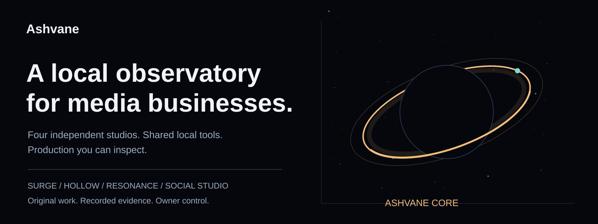
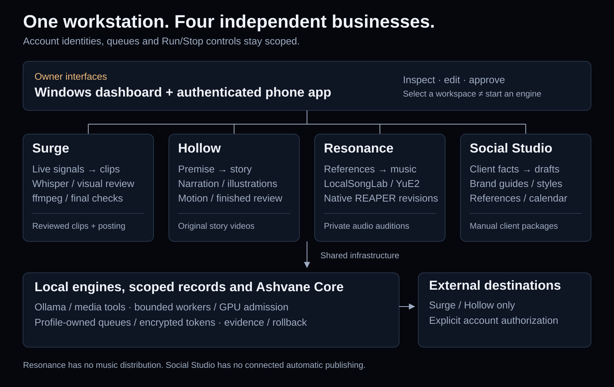
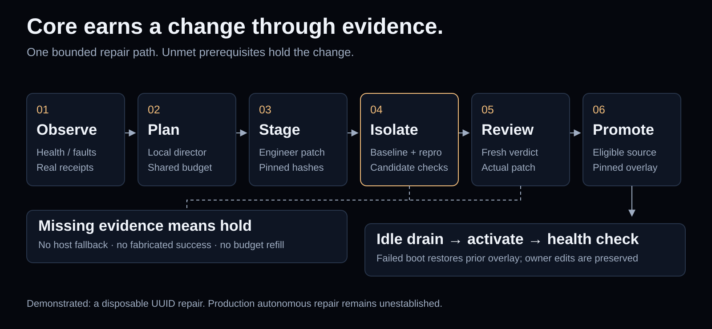

<p align="center"></p>

<p align="center"><b>Surge · Hollow · Resonance · Social Studio</b><br>Local production, independent accounts, inspectable work.</p>

<p align="center"><a href="docs/SETUP.md">Set up</a> · <a href="docs/COMPANY_BRIEFING.html">Company briefing</a> · <a href="docs/ASHVANE_DEEP_DIVE.md">Technical deep dive</a> · <a href="docs/STATUS.md">Evidence & status</a> · <a href="phone/README.md">Phone</a></p>

**Ashvane** is an owner-operated media workbench for Windows with a native phone project.
Four independent workspaces share local tools and a maintenance system called **Core**.
Local AI, editable outputs and recorded evidence keep the production process inspectable.
Application source is **AGPL-3.0**. No hosted inference subscription is required by the local
workflow; hardware, storage, external software and platform prerequisites still apply.

| Workspace | What it does | Current boundary |
|---|---|---|
| **Surge** | Detects Twitch/Kick moments, transcribes, reviews, edits vertical clips and schedules supported destinations | Connected profile, usable source/model and finished-media checks required |
| **Hollow** | Writes original scary stories with narration, configured local illustration/motion, rendering and separate publishing; assembles saved stories into compilations | Visual engines/weights installed separately; compilation source and packaged execution verified |
| **Resonance** | Generates local music, manages references and edits/exports real REAPER revisions | Private auditions; no music distribution or automatic release approval |
| **Social Studio** | Keeps client facts, brand/style rules, drafts, references and a manual calendar | No connected automatic publishing |

Each business has its own persisted Run/Stop control. Selecting a workspace never starts
its engine. Surge and Hollow publishing accounts and queues remain separate; a new account
profile does not inherit another channel's authorization.

## How the system fits together



Surge combines rolling capture, chat/keyword/audio signals, timed transcription and a viewer
rubric. A separate check examines the **finished export and public metadata** before upload.
Studio changes invalidate relevant approval. Its publishers cover YouTube Shorts, TikTok,
Instagram Reels, Facebook Page Reels and Discord, subject to usable provider authorization.
Hollow owns its own publishing connections. Resonance and Social Studio retain the limits above.

Core receives bounded runtime observations and real tool receipts, checks model/resource
readiness and can stage source repairs through isolated execution and independent review.
Its original observatory visualizes reported work; it does not display neural weights.



A real local-model trial repaired a **disposable UUID example**, passed Docker checks and
independent review, applied disposable source and staged a reversible overlay. This verifies
a narrow repair mechanism, not an autonomous production fix. Core records outcome memory and
eligible examples; it does not train model weights or claim consciousness.

## Start with one business

Use a release installer or run the Python 3.12 source with ffmpeg/ffprobe and Ollama.
Check Setup, installed models, data folders and the intended account profile before enabling
capture or publishing. More engines require their own installations and resource budgets.
REAPER is separately licensed. [Setup and prerequisites](docs/SETUP.md).

```powershell
py -3.12 -m venv .venv
.venv\Scripts\python -m pip install -r requirements.txt
.venv\Scripts\python -m clipbot --window
```

The phone connects to your running PC through the existing authenticated remote interface.
The Interstellar source has Expo export and browser-fixture evidence. **A new IPA awaits native
CI; physical iPhone validation is not claimed.** Stable [phone release/feed links](phone/README.md)
remain unchanged. An Expo export is not an installable phone package.

## Evidence before promises

The dated [status page](docs/STATUS.md) separates source implementation, controlled checks,
installed behavior and pending work. A recorded YouTube Analytics request returned five of eight
requested video rows; the other three remain unknown. Sampled frame review does not establish
full caption/audio inspection. Tests and model scores do not guarantee content quality, reach,
account standing or income.

| Read next | Purpose |
|---|---|
| [Company briefing](docs/COMPANY_BRIEFING.html) | Original responsive presentation; download/open the HTML or serve the repository locally |
| [Inside Ashvane](docs/ASHVANE_DEEP_DIVE.md) | UI, pipelines, engines, Core, profiles, privacy, licensing and technical source map |
| [Capability status](docs/STATUS.md) | Demonstrated evidence and explicit unfinished work |
| [AutoClip.dev comparison](docs/AUTOCLIP_COMPARISON.md) | Official-source research; vendor claims separated from testing |
| [Improvement priorities](docs/IMPROVEMENT_PRIORITIES.md) | Proposed changes, acceptance evidence and tradeoffs |
| [Business boundaries](docs/BUSINESSES.md) | Independent engines, accounts and creative memory |
| [Phone setup](phone/README.md) | Existing native build, release and sideload instructions |
| [Changelog](CHANGELOG.md) | Release history |

## Develop and contribute

The implementation lives in `clipbot/`, the desktop interface in `clipbot/dashboard/`,
the native app in `phone/`, external adapters in `integrations/`, and packaging in `installer/`.
Settings are generated from labeled configuration fields. Before proposing changes, read
[CLAUDE.md](CLAUDE.md), preserve business/account boundaries and run the appropriate checks.

```powershell
.venv\Scripts\python -m pytest -q
```

The source suite, frozen application and installed runtime require distinct verification.
Do not publish credentials, account stores, callback URLs or private media in issues/receipts.
The new public visuals are original SVGs; [design decisions](docs/brand/DESIGN.md) document the
palette and semantic layout. Existing Blender art remains in `art/`.

## License and external services

[GNU AGPL-3.0](LICENSE) applies to Ashvane application source.
[Third-party notices](NOTICE.md), [terms](TERMS.md) and [privacy](PRIVACY.md) are separate references.
External models, REAPER, platform APIs and source media keep their own terms. You must have the
rights and account permissions for the content you publish. Ashvane is not affiliated with Twitch,
Kick, Google/YouTube, TikTok, Meta, Discord or the model/software vendors named here.

Local inference and storage do not eliminate network activity: source streams, public research,
model downloads, updates, authorized analytics and uploads use their respective services.
